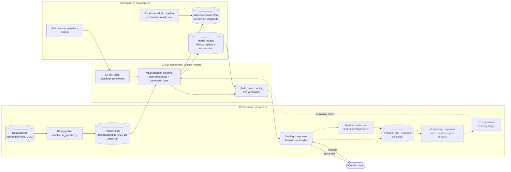
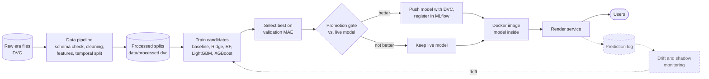
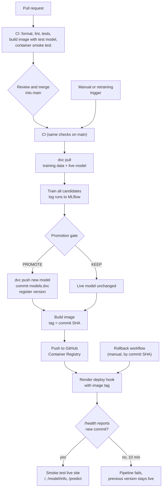
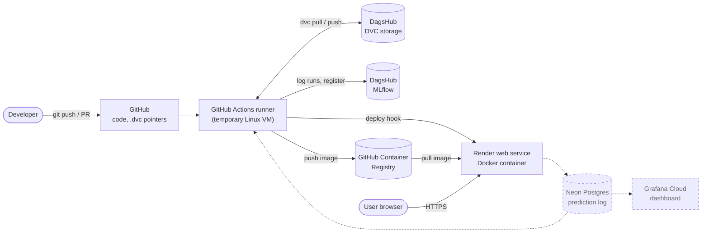
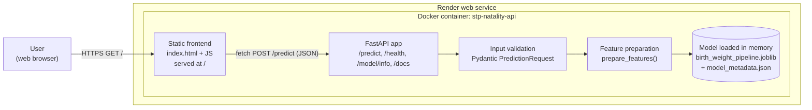
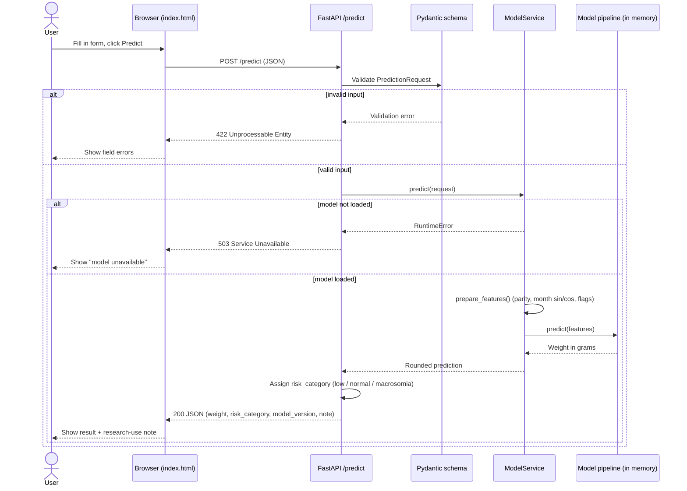
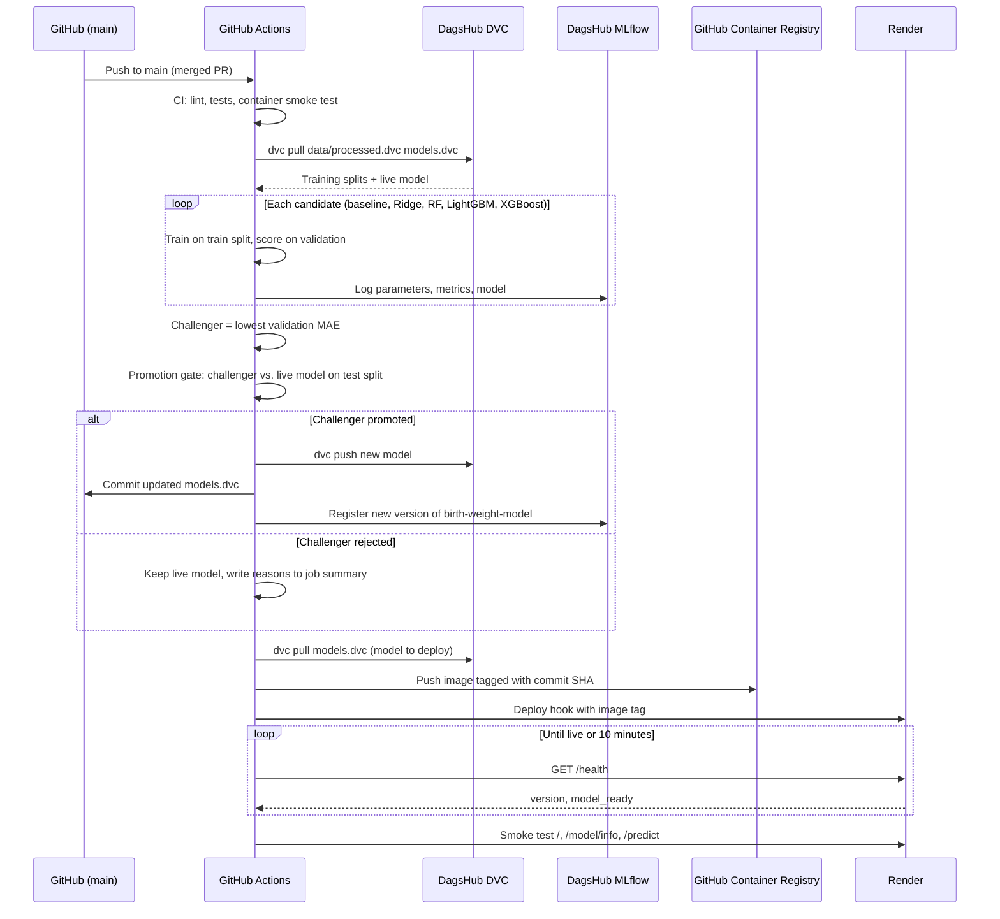
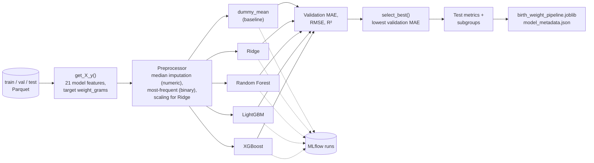

# Architecture

This document maps the system to the components of the MLOps-based Data Science
Process Model (MLOps-DSPM). Components drawn with a **dashed border** are
planned and not yet in production; everything else is implemented.

## 1. MLOps components (development and production environment)

## 2. Lifecycle flow

## 3. CI/CD pipeline

## 4. Deployment view

The raw data, processed splits, trained models and experiment records are not
committed to Git. Git holds the code and the DVC pointers that identify the
exact data and model versions.

## 5. Container view

One Docker container holds the frontend, the API and the model. See
[ADR 001](decisions/001-single-container-deployment.md).

## 6. Prediction request sequence

## 7. Training and promotion sequence

What happens in the CD pipeline after a merge into `main`. See
[ADR 003](decisions/003-training-pipeline-and-promotion-gate.md).

## 8. Analytical pipeline architecture

