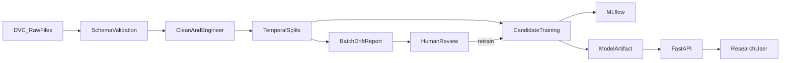
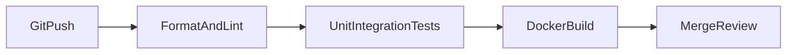

# Architecture

## End-to-end system

## CI path

The raw data, processed splits, model artifacts, and experiment database are not
committed to Git. Git contains the contracts and executable code needed to
recreate them.
