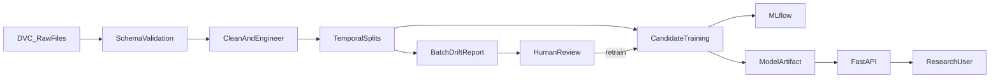
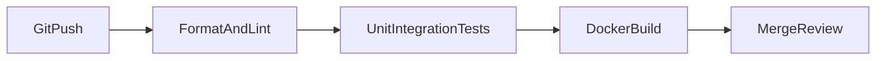
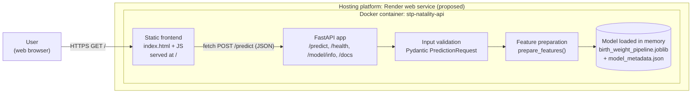
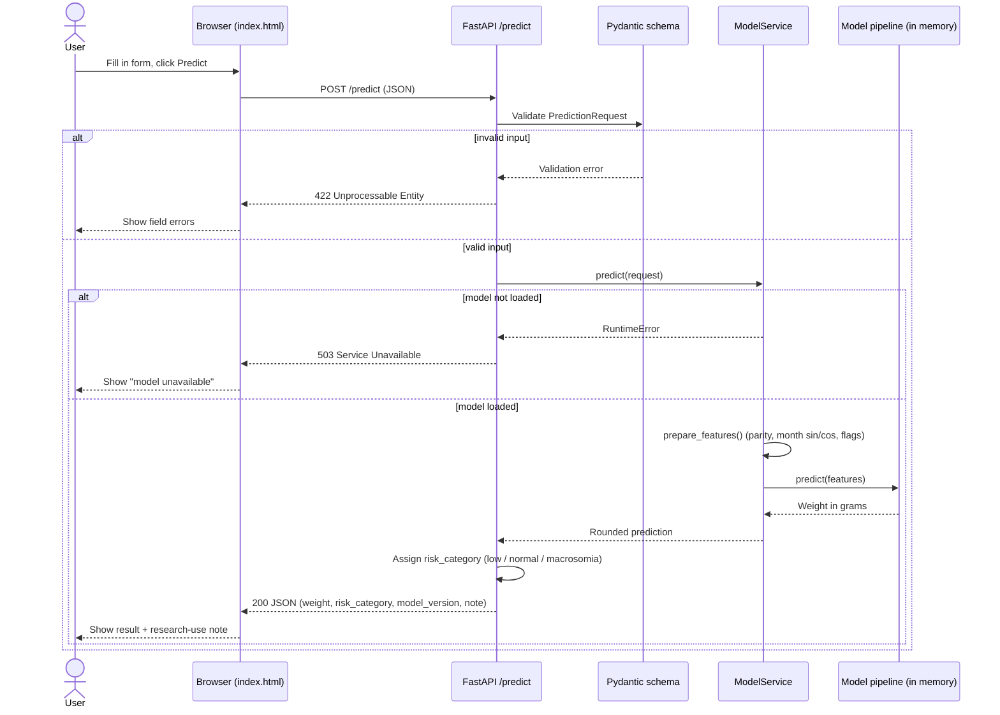

# Architecture

## End-to-end system

## CI path

The raw data, processed splits, model artifacts, and experiment database are not
committed to Git. Git contains the contracts and executable code needed to
recreate them.

## Container view

One Docker container holds the frontend, the API and the model. See
[ADR 001](decisions/001-single-container-deployment.md).

## Prediction request sequence

